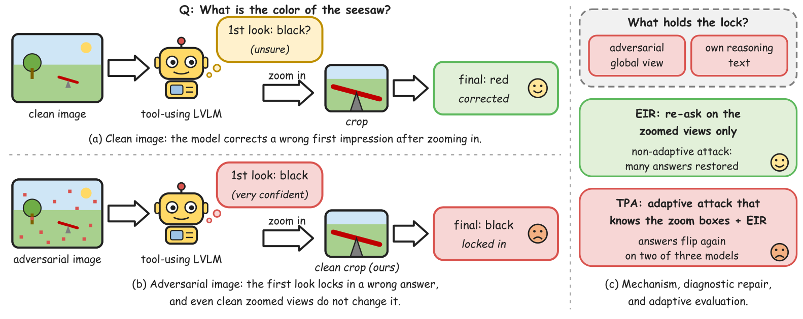
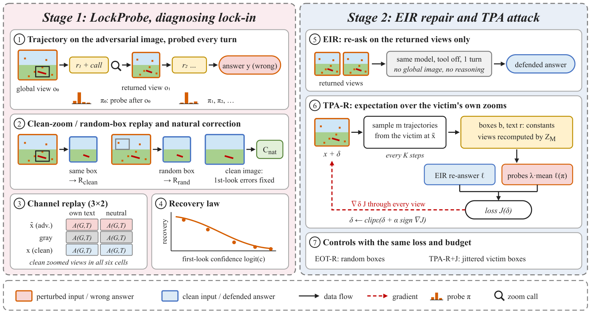
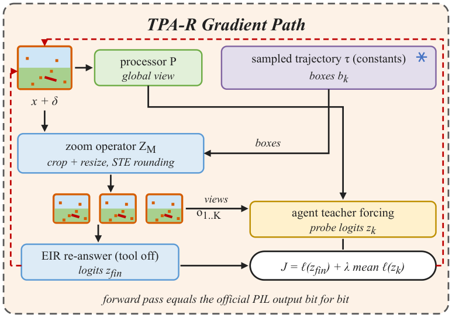

# First-look lock-in in reasoning vision–language models that zoom

Code for LockProbe, evidence-isolated re-answering (EIR) and the trajectory-persistent attack (TPA).

Reasoning vision–language models that zoom into image regions should be able to check a first impression against closer evidence. Under adversarial images they do not. LockProbe reads the model's answer after every turn and replaces each zoomed view with the clean crop at the same box. On six reasoning models with trained or prompted zoom tools, white-box perturbations fix the answer at the first look: clean zoomed views restore at most 11% of the flipped answers, whereas the same models correct 16–67% of their own first-look errors on clean images. EIR, a training-free repair, restores 29–58% of the flipped answers on five models. TPA samples the victim's own zoom trajectories and bypasses EIR on two of the three tool-trained models.



## Method overview



LockProbe reads a forced-answer probe after every returned view. It then regenerates the trajectory with every returned view replaced by the clean crop at the model's own box (clean-zoom replay) or at a random box, and compares the recovery with the model's natural correction rate on clean images. A 3×2 replay separates the adversarial global image from the reasoning text. A cell shows lock-in if |F_z| ≥ 10, R_clean ≤ 0.10, R_clean − R_rand ≤ 0.10 and C_nat − R_clean ≥ 0.15.

EIR gives the same model only the views returned during the trajectory, in a new tool-free turn without the global image or the earlier reasoning. TPA takes the attack loss in expectation over the victim's own sampled zoom trajectories, resampled during PGD, and TPA-R adds the EIR decision to the objective.



TPA-R gradient path for one sampled trajectory. Boxes and reasoning text are constants. Every view is recomputed from `x + δ` by a differentiable zoom operator whose forward pass matches the official PIL implementation exactly.

## Repository layout

| Path | Content |
|---|---|
| `code/tpa/models/` | Tool-using agents for the six victims (`qwen_agent.py`: DeepEyes and prompted Qwen3-VL; `minio3_agent.py`; `pixelreasoner_agent.py`; `glm_agent.py`), model registry |
| `code/tpa/processors/` | Differentiable re-implementation of the zoom operators and image processors (straight-through 8-bit rounding) |
| `code/tpa/attacks/tpa.py` | Single-view PGD, EOT, TPA, TPA-R, TPA-R+J and EOT-R |
| `code/tpa/defenses/eir.py` | Evidence-isolated re-answering |
| `code/tpa/eval/parser.py` | Rule-based answer parser |
| `code/tpa/metrics/` | Cluster bootstrap and summary statistics |
| `code/scripts/gen_adv.py`, `eval_adv.py` | Generate adversarial images; evaluate with free generation and per-turn probes |
| `code/scripts/pilot_defense.py`, `pilot_mech.py`, `pilot_remedy.py` | Clean-zoom / random-box replays, channel replay, EIR re-answering |
| `code/scripts/s12_e*.sh` | Experiment drivers (E1 lock-in, E2 channels, E3 recovery law, E4 EIR and adaptive evaluation, E5–E7 small budget, zoom budget, remote sensing) |
| `code/scripts/s12_e*_report.py`, `s18_verify.py`, `s24_derived.py` | Reports, independent recomputation, post hoc analyses |
| `code/scripts/make_paper_figures.py`, `make_paper_tables.py` | Figures and tables from the released statistics |
| `code/configs/` | Protocol (`protocol_v2.yaml`), question splits, question lists of the adaptive evaluation, parser audit set, pinned requirements |
| `code/tests/` | Unit tests of the zoom operators, processors, probes and parser |

## Setup

The experiments were run with Python 3.14 and the pinned packages in `code/configs/requirements.txt` (PyTorch, Transformers, bitsandbytes).

```bash
python -m venv venv
venv/bin/pip install -r code/configs/requirements.txt
export TPA_ROOT=$PWD
```

Model weights and benchmarks are not included. `code/scripts/download_assets.py` downloads them from the Hugging Face Hub into `models/` and `datasets/` (see `code/configs/paths.yaml` and `code/tpa/models/registry.py`):

- Victims: DeepEyes-7B, Mini-o3-7B, PixelReasoner-RL-v1, Qwen3-VL-4B/8B-Thinking, GLM-4.1V-9B-Thinking.
- Benchmarks: V* Bench, HR-Bench 4K, XLRS-Bench-lite.

Every model is loaded with an NF4 language model and a bf16 vision tower. A single-view attack fits in 16 GB of GPU memory; TPA-R on Mini-o3 needs up to 25 GB.

## Running the experiments

The drivers write fixed command lists and run them with `code/scripts/gpu_pool.py`. Every command is resumable.

```bash
bash code/scripts/s12_e1.sh "deepeyes_7b minio3_7b"     # white-box cells, evaluation, clean-zoom / random-box replays
bash code/scripts/s12_e1_transfer.sh "minio3_7b pixelreasoner_7b"   # DeepEyes eps=8 images transferred to other victims
bash code/scripts/s12_e2_e4r.sh deepeyes_7b             # channel replay and non-adaptive EIR
bash code/scripts/s12_e3.sh deepeyes_7b                 # PGD iterates for the recovery law
bash code/scripts/s12_e4a.sh deepeyes_7b                # adaptive evaluation: TPA-R, TPA-R+J, EOT-R through EIR
bash code/scripts/s12_e567.sh E6 minio3_7b              # E5 (eps = 2/255), E6 (zoom budget), E7 (XLRS-Bench)
```

Each driver documents its arguments in its header. Individual steps can also be run directly, for example:

```bash
venv/bin/python code/scripts/gen_adv.py --exp E1 --split v2_main --limit 150 --method single_view --source deepeyes_7b --eps 8
venv/bin/python code/scripts/eval_adv.py --exp E1 --split v2_main --limit 150 --eval_model deepeyes_7b --adv single_view@deepeyes_7b__eps8__seed0
venv/bin/python code/scripts/pilot_defense.py --out_exp E1 --only_flipped --split v2_main --adv_exp E1 --cond clean_zoom --model deepeyes_7b --adv single_view@deepeyes_7b__eps8__seed0
```

Adversarial images go to `results/adv/` and item-level records to `results/raw/`. The `s12_e*_report.py` scripts turn the records into the statistics of the paper, `s18_verify.py` recomputes them independently from the records, and `s24_derived.py` computes the post hoc analyses (recovery-law fit, comparison with natural errors, view statistics).

## Tests

```bash
venv/bin/python -m pytest code/tests
```

## Citation

The paper is under review. A citation entry will be added on publication.
